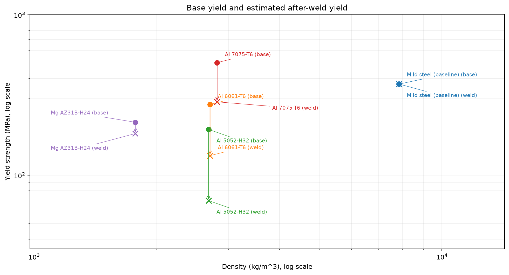
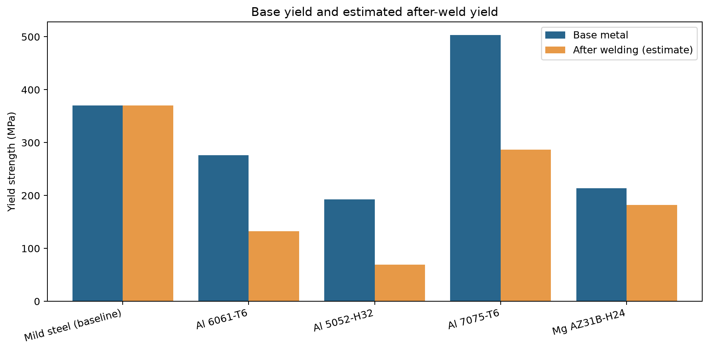
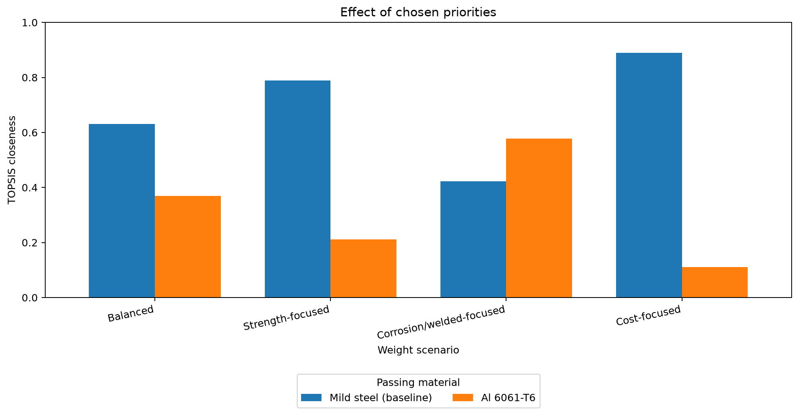

# Mechanical Material Selection for an EV Battery Enclosure using Ashby Screening and TOPSIS.

This Python project compares sheet-metal candidates for a welded EV battery enclosure.
It considers lightweight performance, strength after welding, corrosion, and price.
Ashby screening identifies eligible materials; TOPSIS evaluates the passing candidates.

## Objective

- Screen candidates against corrosion, price, and welded-strength requirements.
- Compare passing materials using five weighted criteria.
- Examine the effect of different priorities.

## Project structure

```text
material-selection-ev-enclosure/
|-- data.csv
|-- material_selection_ev_enclosure.ipynb
|-- README.md
`-- outputs/
    |-- charts as PNG
    `-- result tables as CSV
```

`data.csv` contains the supplied inputs. The notebook runs the analysis and creates `outputs/` for the saved tables and charts.

## Materials compared

- **Mild steel (baseline):** a low-cost reference with high density.
- **Al 6061-T6:** a candidate balancing strength, density, and corrosion resistance.
- **Al 5052-H32:** a sheet alloy included for corrosion and welding considerations.
- **Al 7075-T6:** a high-strength base metal included for comparison.
- **Mg AZ31B-H24:** a low-density option with corrosion considerations.

## Method in simple words

**Ashby screening:** materials must meet the corrosion, price, and after-weld yield limits. Missing weld-retention or price inputs also prevent entry into TOPSIS.

- After-weld yield = base yield * weld retention.
- Strong-panel index = `sqrt(yield) / density`, multiplied by 1000 for readability.
- Higher indices favor lightweight panels under strength-limited bending, with fixed plan dimensions and adjustable thickness. Yield uses MPa and density uses kg/m^3.

**TOPSIS:** find the candidate closest to an ideal best and furthest from an ideal worst.

1. Normalize: `r_ij = x_ij / sqrt(sum_i(x_ij^2))`.
2. Apply weights: `v_ij = w_j * r_ij`.
3. Set ideal best/worst: maximum/minimum for benefits; minimum/maximum for cost.
4. Measure distances: `D_best_i = sqrt(sum_j((v_ij - best_j)^2))`, and similarly for `D_worst_i`.
5. Calculate closeness: `C_i = D_worst_i / (D_best_i + D_worst_i)`. Higher scores rank first.

Here `i` is a material and `j` is a criterion. In order, the criteria are after-weld yield, weld retention, corrosion score, price per kg, and after-weld Ashby index. Price is the only cost criterion. Default weights are 0.25, 0.20, 0.20, 0.15, and 0.20.

**Sensitivity analysis:** repeat TOPSIS for Balanced, Strength-focused, Corrosion/welded-focused, and Cost-focused priorities. A single candidate receives neutral closeness 0.5 because both ideal distances are zero.

## Material behavior relevant to the design

- **Precipitation hardening:** strengthening particles in T6 alloys can change under weld heat.
- **Work hardening:** cold working strengthens 5052-H32; weld heat can reduce that strengthening.
- **HAZ softening:** the heat-affected zone is heated without melting and can lose strength.
- **Galvanic corrosion:** dissimilar metals in electrical contact can corrode in a wet environment.

## Input data

The CSV contains the supplied study inputs. Aluminium prices are assumed midpoint estimates; magnesium uses an ingot price. The 7075 and magnesium retention factors describe UTS efficiency and are used here as yield-retention proxies, not measured welded-yield values.

| Column | Meaning |
|---|---|
| material | Material name and temper |
| density_kg_m3 | Density in kg/m^3 |
| yield_MPa | Base-metal yield strength in MPa |
| weld_retention | Factor used to estimate after-weld yield (including the stated UTS proxies) |
| corrosion_grade | Assigned grade from A (best) to E (worst) |
| price_usd_per_kg | Supplied price input in USD/kg |

The score mapping is A=9, B=7, C=5, D=3, E=1. All five rows now have complete numerical inputs; corrosion grades remain the supplied judgments.

## Output files

| File in outputs/ | Contents |
|---|---|
| ashby_calculations.csv | Inputs, corrosion scores, welded yield, and both Ashby indices |
| screening_result.csv | Screening status and reasons for each material |
| ashby_chart.png | Density versus base and known after-weld yield |
| yield_comparison.png | Base and after-weld yield comparison |
| topsis_ranking.csv | Criteria, closeness, and rank for passing materials |
| sensitivity_ranks.csv | Material ranks across four scenarios |
| sensitivity_chart.png | Closeness scores across four scenarios |

## How to run

From this project folder:

```text
pip install pandas numpy matplotlib jupyter
jupyter notebook material_selection_ev_enclosure.ipynb
```

Keep `data.csv` beside the notebook, then restart the kernel and run all cells from top to bottom. The notebook saves all seven output files in `outputs/`.

## Results

The study accepts a minimum corrosion score of **3 (grade D or better)**.

Other screening requirements: price at most **$5.00/kg** and estimated after-weld yield at least **100 MPa**.

**2 materials pass screening:** Mild steel (baseline), Al 6061-T6.

- **Default-weight winner: Mild steel (baseline).**
- **Corrosion/welded-focused winner: Al 6061-T6.**

### Screening

| Material | Status | Reason |
| --- | --- | --- |
| Mild steel (baseline) | PASS | Meets all limits |
| Al 6061-T6 | PASS | Meets all limits |
| Al 5052-H32 | ELIMINATED | after-weld yield below minimum |
| Al 7075-T6 | ELIMINATED | price above maximum |
| Mg AZ31B-H24 | ELIMINATED | corrosion score below minimum |

### Calculated properties

| Material | Base yield (MPa) | Estimated after-weld yield (MPa) | After-weld Ashby index | Price input (USD/kg) |
| --- | --- | --- | --- | --- |
| Mild steel (baseline) | 370.00 | 370.00 | 2.450 | 0.55 |
| Al 6061-T6 | 276.00 | 132.48 | 4.263 | 4.00 |
| Al 5052-H32 | 193.00 | 69.48 | 3.110 | 3.25 |
| Al 7075-T6 | 503.00 | 286.71 | 6.026 | 5.75 |
| Mg AZ31B-H24 | 214.00 | 181.90 | 7.620 | 2.30 |

### TOPSIS ranking

| Rank | Material | TOPSIS closeness |
| --- | --- | --- |
| 1 | Mild steel (baseline) | 0.6307 |
| 2 | Al 6061-T6 | 0.3693 |

### Weight scenarios

| Material | Balanced | Strength-focused | Corrosion/welded-focused | Cost-focused |
| --- | --- | --- | --- | --- |
| Mild steel (baseline) | 1 | 1 | 2 | 1 |
| Al 6061-T6 | 2 | 2 | 1 | 2 |

**Corrosion/welded-focused changes the winner to Al 6061-T6.** The preferred material changes with the priorities assigned to the criteria.

### Graphs






